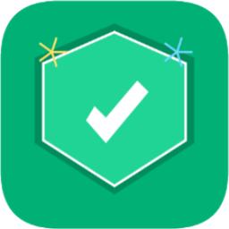

<p align="center">
  
</p>

<h1 align="center">원터치 악성 앱 클리너</h1>

<p align="center">
  <b>AI가 가짜 팝업을 가려내고, 시니어가 혼자서도 악성 앱을 지우도록 이끄는 원터치 보안 도우미</b><br />
  NEXT AI 해커톤 2026 출품작 (주제: 「내 전공 현장을 바꾸는 AI」)
</p>

<p align="center">
  <b>체험하기: <a href="https://kjykjy3151-eng.github.io/onetouch-senior-cleaner/">kjykjy3151-eng.github.io/onetouch-senior-cleaner</a></b><br />
  (배포 주소의 AI 판별은 Vercel 서버 함수가 맡습니다. 서버가 연결되지 않았을 때는 예시 팝업으로만 동작합니다.)
</p>

---

## 해결할 문제

스마트폰이 익숙하지 않은 5060+ 세대는 **가짜 경고 팝업과 진짜 시스템 알림을 구별하지 못해** 악성 앱을 반복 설치하고, 혼자서는 지우지 못해 가족에게 의존하게 됩니다.

> "빨간색으로 긴급하다고 뜨면 폰이 고장 날까 봐 무서워서 일단 시키는 대로 누르게 돼요."
> "자식들한테 매번 폰 이상하다고 봐달라고 하기도 미안하고 눈치 보여서, 나중엔 그냥 광고가 떠도 참게 돼요."
> (사용자 인터뷰 중)

2025년 스미싱 중 공공기관 사칭이 59.4%, 청첩장, 부고장 같은 지인 사칭이 15.5%였고(과학기술정보통신부 등 관계부처, 2025.1), 악성 앱 피해자 다수가 50대 이상이었습니다(서울경찰청 수사 결과, 2025.11).

## 주요 기능

| 기능 | 설명 |
| --- | --- |
| **AI 팝업 판별** "이 팝업, 진짜일까요?" | 수상한 화면 사진을 올리면 AI가 진짜와 가짜를 판별하고, 단서, 알려진 수법, 할 일, **직접 확인하는 법**을 쉬운 말로 알려 줍니다. |
| **신고하고 없애기** | 가짜로 판정되면 신고를 바로 접수하고, 휴대폰별(갤럭시, 다른 안드로이드, 아이폰) 단계 안내로 광고를 없앱니다. 단계마다 사용자가 진행 여부를 고릅니다. |
| **원터치 청소** | 의심 앱을 찾아 보여 주고, 누를 곳을 노란 테두리로 짚는 3단계 삭제 가이드로 끝까지 안내합니다. |
| **신고 순위** | 이번 달 신고가 많은 앱 TOP 5와 더보기 |
| **인터넷 알림 광고 끄기** | 앱을 지워도 광고가 뜰 때, 삼성 인터넷, 크롬별로 사이트 알림 끄는 법을 안내합니다. |
| **이 앱의 안전 약속** | 받지 않은 "공식 인증" 표시 대신, 이 앱이 하지 않는 일과 가짜 보안 앱 구별법을 보여 줍니다. |
| **쉽게 설치하기** | 앱스토어 없이 홈 화면에 추가(PWA), 자녀가 보내는 가족 링크 |
| **시니어 접근성** | 밝고 따뜻한 테마, 음성 안내, 글자 크기 3단계, 명암비 4.5:1, 버튼 52px 이상, 버튼 간격 20px 이상 |

## AI가 배우는 방식

AI를 직접 재학습시키는 대신, **판별할 때마다 참고서를 함께 주는 방식**입니다.

1. **판별 지식집** (`server/knowledge.js`): 출시 전에 조사한 실제 가짜 수법 7가지, 진짜 경고 4가지(무섭게 생겼지만 진짜인 Google Play 프로텍트 경고 포함), 진짜인지 확인하는 법 7가지. 근거는 KISA, 경찰청, 과학기술정보통신부, Google, FTC 자료입니다.
2. **데이터 쌓기** (`server/caseStore.js`): 판별 결과와 사용자 피드백("맞았어요", "틀렸어요")을 쌓고, 사용자가 확인해 준 가짜 사례를 다음 판별에 참고합니다. **사진은 저장하지 않습니다.**
3. **안전장치**: 확신이 높지 않은 "진짜" 판정은 "판단 어려움"으로 낮춥니다. 가짜를 진짜로 알려 주는 것이 가장 위험한 오류이기 때문입니다. "사실은 진짜였다"는 피드백은 AI를 속이는 데 쓰일 수 있어 자동으로 반영하지 않습니다.

### 판별 성능 (`npm run eval:ai`)

Gemini `gemini-3.1-flash-lite`, 시험 사진 10장(가짜 5, 진짜 5) × 3회, 2026-11-05 측정

| 항목 | 지식집 없음 | 지식집 사용 |
| --- | --- | --- |
| 진짜와 가짜 판정 정답률 | 100% (30/30) | 100% (30/30) |
| 가장 위험한 오류 (가짜를 진짜로) | 0회 | 0회 |
| 수법 분류 정확도 | 77% (23/30) | **100% (30/30)** |
| 평균 응답 시간 | 2.3초 | 2.4초 |

> 시험 사진은 직접 그린 단순한 화면이라, 실제 휴대폰 캡처에서도 같은 성능이라고 단정할 수 없습니다. 실제 캡처로 측정 세트를 늘리는 것이 다음 과제입니다.

## 실행 방법

```bash
npm install
cp .env.example .env    # .env 에 AI 키 하나를 넣습니다 (무료: GEMINI_API_KEY)
npm run dev             # http://localhost:5173
```

- 키가 없어도 실행됩니다. 이때 AI 판별은 앱에 들어 있는 예시 팝업 2종만 준비된 결과로 보여 줍니다.
- AI 판별 성능 측정: `npm run eval:ai -- 3` (지식집 없이 비교: `--no-knowledge`)
- API 키는 Vite 개발 서버 안에서만 쓰이고 브라우저로 보내지지 않습니다.
- `main` 브랜치에 올리면 GitHub Actions가 GitHub Pages로 자동 배포합니다(`.github/workflows/deploy-pages.yml`).

## 배포 구조

```
휴대폰 → GitHub Pages (화면) → Vercel 서버 함수 api/index.js (키 보관) → Gemini
                                        └→ Upstash Redis (판별 사례, 피드백)
```

- **화면:** `main`에 올리면 GitHub Actions가 GitHub Pages로 배포합니다. 저장소의 Actions 변수 `API_BASE_URL`에 Vercel 주소가 있으면 그 서버로 AI 판별을 요청합니다.
- **AI 서버:** Vercel이 같은 저장소의 `api/index.js`를 서버 함수로 배포합니다. 노트북 개발 서버와 같은 판별 코드(지식집, 안전장치)를 씁니다.
- **보안과 남용 방지:** 키는 Vercel 환경 변수에만 둡니다. 허용한 화면 주소(`ALLOWED_ORIGINS`, 기본 github.io)에서 온 요청만 받고, 모든 사용자 합계 1분 20회, 하루 300회까지만 AI에 보냅니다(`QUOTA_PER_MINUTE`, `QUOTA_PER_DAY`).

| Vercel 환경 변수 | 내용 |
| --- | --- |
| `GEMINI_API_KEY` | 필수. Gemini 키 |
| `KV_REST_API_URL`, `KV_REST_API_TOKEN` | Vercel에서 Upstash Redis를 연결하면 자동으로 들어감 |
| `ALLOWED_ORIGINS` | 선택. 기본 `https://kjykjy3151-eng.github.io` |

## 기술 스택

React 19, Vite 8, Tailwind CSS v4, Lucide 아이콘, canvas-confetti, Google Gemini API(`@google/genai`), Anthropic API(`@anthropic-ai/sdk`, 선택), Web Speech API, PWA, GitHub Pages, Vercel Functions, Upstash Redis

**교내 GPU(틸론) 활용:** 앱 로고를 틸론 주피터 노트북에서 Python matplotlib으로 직접 그려 앱 상단 로고와 홈 화면 아이콘에 반영했습니다. 코드와 결과 이미지는 [`notebooks/`](notebooks/) 폴더에 있습니다.

## 시연용 범위

해커톤 프로토타입이라 일부 기능은 화면 흉내입니다.

| 실제로 동작 | 시연용 |
| --- | --- |
| AI 팝업 판별, 판별 지식집, 사례 쌓기와 피드백 | 의심 앱 스캔과 삭제 (웹은 휴대폰 앱 목록을 읽을 수 없음) |
| 신고하고 없애기, 알림 끄기 단계 안내 | 신고 접수 (실제 KISA로 전송하지 않음) |
| 홈 화면에 추가, 가족 링크 (배포 주소 필요) | 신고 순위의 다른 사용자 데이터 |
| 음성 안내, 글자 크기 | |

자세한 구현 기록, 결정 이유, 한계와 남은 작업은 [IMPL-PLAN.md](IMPL-PLAN.md)에 있습니다.
